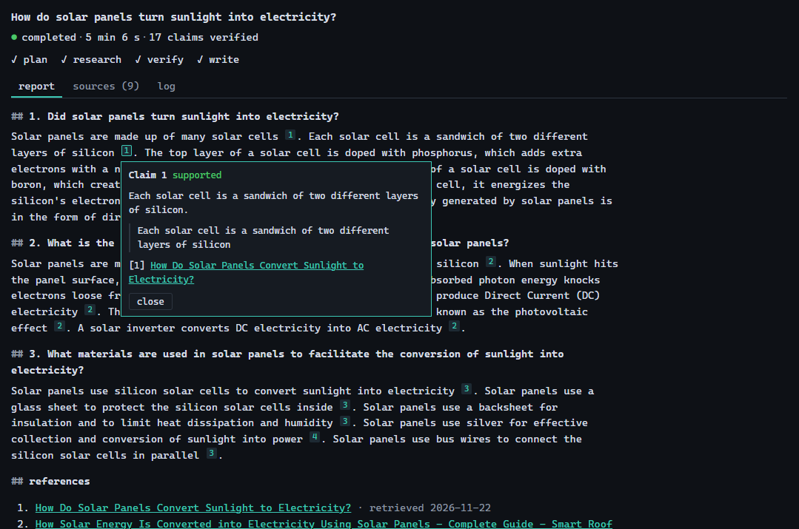
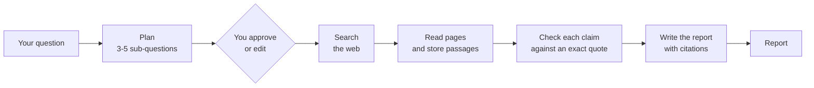
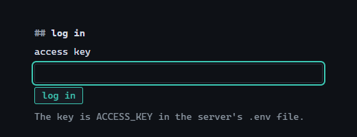
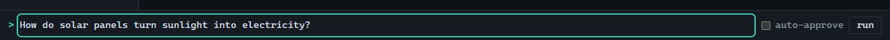
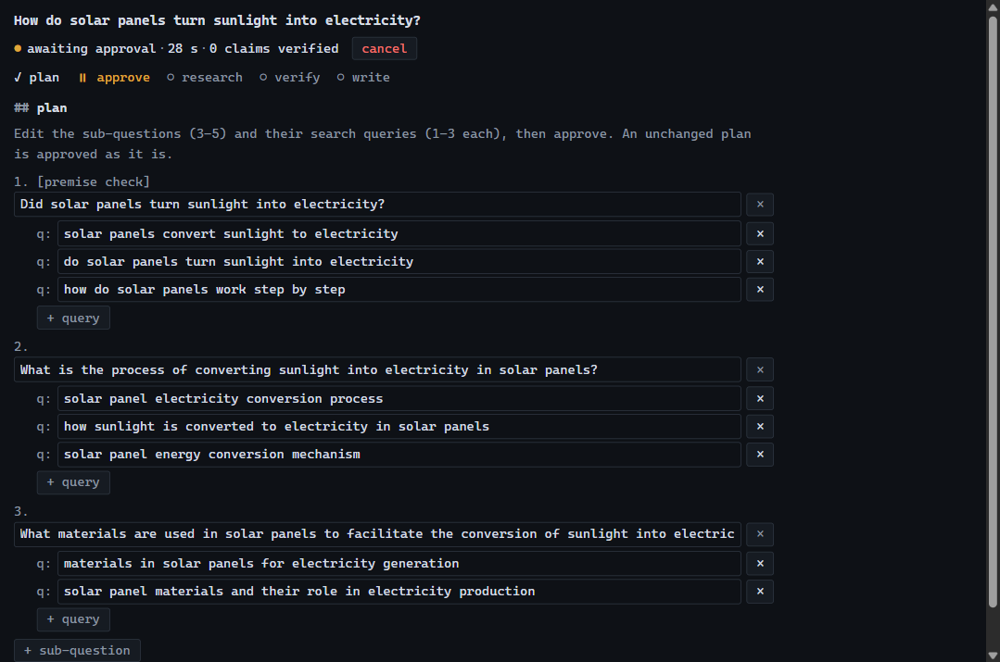
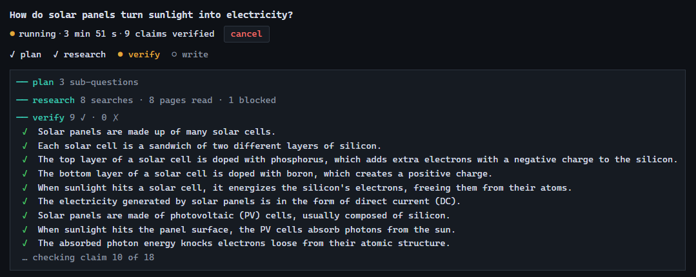
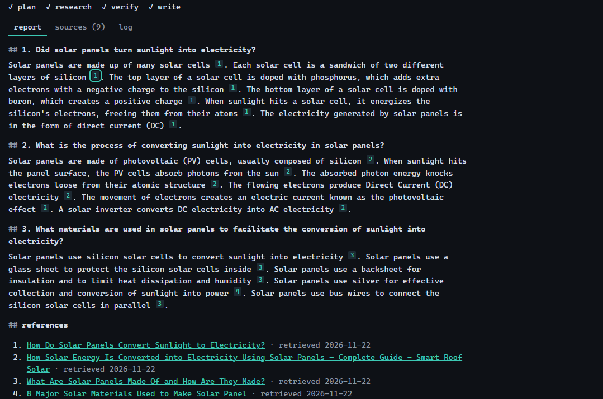
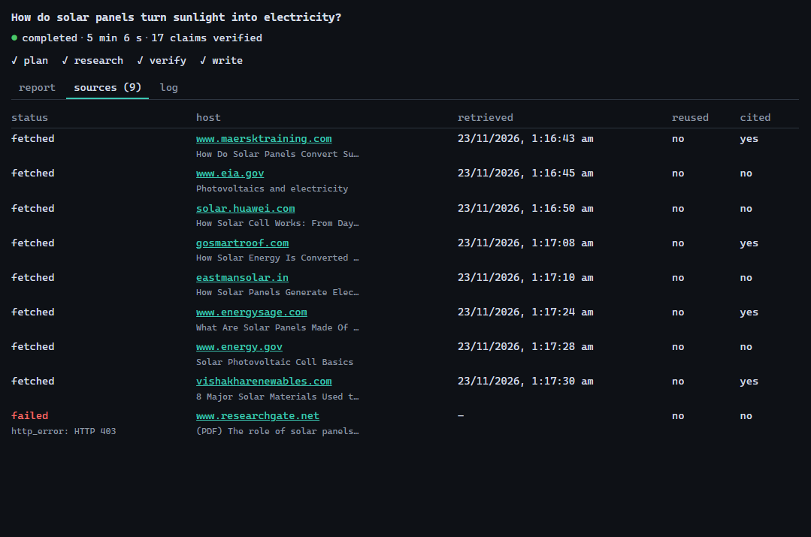

# Research Assistant

Ask a question, and it researches the web on your own computer and writes a short report in which every sentence is backed by a quote from a real web page.



Everything runs on your machine. There are no cloud services, no accounts and no API keys. All the software it uses is free and open source.

## What it does

1. **Plan.** It splits your question into 3 to 5 smaller sub-questions. You can edit them before it starts.
2. **Search.** It searches the web for each sub-question through SearXNG, a search tool that runs on your computer.
3. **Read.** It downloads the best pages, cuts them into short passages and stores them.
4. **Check.** It writes down short claims from those passages. Then it checks each claim against an exact quote from the stored page.
5. **Write.** It writes a report from the checked claims only. Every sentence gets a citation number.



## Why you can trust the answers

- **Every sentence links to an exact quote.** Click a citation number and you see the quote from the web page, word for word, and a link to that page.
- **The language model never writes links or citations.** It can only point at passages that were really downloaded. The program builds the citations itself and checks them.
- **Unproven claims are dropped.** If no stored quote supports a claim, the claim is not used. A sentence that no checked claim supports is removed from the report.
- **Numbers are checked too.** A claim with a number that is not in its quote is rejected.

**Example.** For the question "How do solar panels turn sunlight into electricity?", the report says:

> Each solar cell is a sandwich of two different layers of silicon **[1]**.

Clicking **[1]** shows the claim, the word `supported`, and this quote from the page "How Do Solar Panels Convert Sunlight to Electricity?":

> Each solar cell is a sandwich of two different layers of silicon

## What you need

| What | Why |
|---|---|
| A computer with an **NVIDIA GPU with 6 GB of memory or more** | Runs the language model fast enough. Without a GPU it works, but many times slower. |
| **16 GB of RAM** | For the model, the database and the browser together. |
| About **10 GB of free disk space** | Models, Docker images and the database. |
| **[Docker Desktop](https://www.docker.com/products/docker-desktop/)** | Runs the app, the database and the search tool. |
| **[Ollama](https://ollama.com)** | Runs the language model on your GPU. |
| **[Git](https://git-scm.com)** | Downloads the code. On Windows it also gives you **Git Bash**, used below. |

All of these are free. It was tested on Windows 11 with an RTX 3050 laptop GPU (6 GB) and 16 GB of RAM.

## Setup

Run every command in **Git Bash** on Windows, or in a terminal on Linux. Copy and paste them one step at a time.

**1. Download the code.**

```
git clone https://github.com/utkarshdhama03/research-assistant.git
cd research-assistant
```

**2. Create your settings file.**

```
cp .env.example .env
```

**3. Fill in the secrets.** These commands put random values into `.env`:

```
sed -i "s/^ACCESS_KEY=.*/ACCESS_KEY=$(openssl rand -hex 32)/" .env
sed -i "s/^SEARXNG_SECRET=.*/SEARXNG_SECRET=$(openssl rand -hex 32)/" .env
PG=$(openssl rand -hex 16)
sed -i "s/^POSTGRES_PASSWORD=.*/POSTGRES_PASSWORD=$PG/; s/research:research@/research:$PG@/" .env
```

**4. Add your contact address.** Websites see it when the app downloads their pages. Replace `you@example.com` with your own email address, then run:

```
sed -i "s/^CONTACT_URL=.*/CONTACT_URL=mailto:you@example.com/" .env
```

The app will not start while the example address is still there, so do not skip this step.

**5. Set up Ollama.** These two settings make the model fit in 6 GB of GPU memory:

```
setx OLLAMA_FLASH_ATTENTION 1
setx OLLAMA_KV_CACHE_TYPE q8_0
```

Now quit Ollama from its icon in the taskbar and start it again. (On Linux, add both settings to the Ollama service with `sudo systemctl edit ollama` and restart it.) Then download the two models:

```
ollama pull qwen3:8b
ollama pull nomic-embed-text
```

**6. Start the app.** Make sure Docker Desktop is running, then:

```
docker compose up -d --build
```

The first start takes a few minutes. Check that it is ready:

```
docker compose ps
```

Wait until `api` and `worker` both say `healthy`.

**7. Log in.** Show your access key:

```
grep ACCESS_KEY .env
```

Open **<http://127.0.0.1:8000>** in your browser. Paste the key (the part after `ACCESS_KEY=`) and click **log in**.



The top bar should say `● all systems ok`. If a part is down, it says which one. Click it for details.

**To stop the app:** `docker compose stop`. **To start it again:** `docker compose up -d`. Your runs and reports are kept.

## How to use it

**1. Ask.** Type your question in the line at the bottom and press Enter. Leave **auto-approve** off the first time.



**2. Approve the plan.** After about 30 seconds the plan appears. You can change the sub-questions and search queries. Then click **approve**. Tick **auto-approve** next time if you want to skip this step.



**3. Watch the progress.** The step line shows where the run is. Below it you see the searches, the pages it read, and a ✓ or ✗ for every claim it checked. A question takes about 5 to 6 minutes.



**4. Read the report.** There is one section per sub-question. The list of sources is at the end, with the date each page was read.



**5. Click a citation.** Click any small number to see the exact quote behind that sentence, and a link to the page. Press Esc or click **close** to close it. (See the picture at the top of this page.)

**6. Check the sources.** The **sources** tab lists every page the run tried: which ones it read, which failed and why, and which ones the report cites.



The **history** list on the left keeps all your runs. Runs keep going even if you close the browser.

## For developers

### How it works

- The **web UI** (React) talks to an **API** (FastAPI). The API puts each new question in a queue in the database.
- A **worker** picks up the run and steps through a graph: plan, wait for approval, research, analyze, verify, write. The graph is built with LangGraph, and its state is saved in Postgres, so a run can wait for your approval and then continue.
- **Research** searches SearXNG, picks pages, downloads them (respecting `robots.txt`), extracts the text and stores it as passages with embeddings (pgvector).
- **Analyze** gives the model the nearest passages for each sub-question. The model answers with claims that point at passage ids, never at URLs.
- **Verify** checks each claim against its passages. The code then finds the quote in the stored text and rejects claims whose quote or numbers are not there.
- **Write** turns the checked claims into sections. The code adds the citation numbers and removes any sentence that no checked claim supports.
- The UI follows a run live through server-sent events.

### Tech stack

| Part | Tools |
|---|---|
| Language model | Ollama with `qwen3:8b` (writing and checking) and `nomic-embed-text` (embeddings) |
| Backend | Python 3.13, FastAPI, LangGraph, SQLAlchemy, Alembic, Pydantic, httpx, trafilatura |
| Database | PostgreSQL 17 with pgvector |
| Search | SearXNG, with DuckDuckGo (ddgs) as a fallback |
| Frontend | React 19, TypeScript, Vite |
| Packaging | Docker Compose, uv, npm |
| Tests | pytest, ruff, mypy, Vitest, Testing Library |

### Folder structure

```
research-assistant/
├── src/research_assistant/   # the app: API, worker, research graph, tools, evaluation
├── frontend/                 # the web UI (React)
├── tests/                    # unit and integration tests, with saved web pages as fixtures
├── migrations/               # database schema changes (Alembic)
├── scripts/                  # checks, backup and restore
├── docker/  searxng/         # settings for the Postgres and SearXNG containers
├── images/                   # pictures for this README
├── Dockerfile
└── docker-compose.yml
```

### Run it without Docker (for development)

```
docker compose up -d postgres searxng    # only the database and search in Docker
uv sync                                  # install Python 3.13 and the dependencies
uv run alembic upgrade head              # create the tables
uv run ra worker                         # terminal 1
uv run ra serve                          # terminal 2: http://127.0.0.1:8000, no login
npm --prefix frontend ci                 # once
npm --prefix frontend run dev            # UI with live reload: http://127.0.0.1:5173
```

`uv run ra research "your question"` runs one question in the terminal and saves the report to `data/reports/`.

### Run the tests

```
sh scripts/check
```

This runs the linter, the formatter check, the type checker, all Python tests and all UI tests. The Python tests need the Docker database (`docker compose up -d postgres`). They never call the real web: they use saved pages in `tests/fixtures/`.

### Run the evaluation

The evaluation asks 16 fixed questions and saves the measurements to `data/evals/<name>/`. Stop the Docker worker first so the two do not share the GPU:

```
docker compose stop worker
uv run ra eval run --dir data/evals/my-eval     # about 1.5 hours; can be resumed
uv run ra eval check data/evals/my-eval         # checks every citation again
uv run ra eval compare data/evals/old-eval data/evals/my-eval
```

Keep a laptop on mains power. On battery the GPU is much slower.

## Results

Measured on the 16-question evaluation (Windows 11, RTX 3050 laptop GPU with 6 GB):

| Measure | Result |
|---|---|
| Questions | 16 (technical, science, history, India, contested topics, and one with a false premise) |
| Citation validity | **100 %**: all 1,669 citation checks passed. Every cited quote really is on its stored page. |
| Supported claims | **84 %** of claims (262 of 312) were judged supported by their quote |
| Median time per question | **340 seconds** (about 5.7 minutes) |
| Runs that finished | 15 completed, 1 partial (two sub-questions got no search results) |

These numbers come from **automatic checks, not from people**. Citation validity is checked by code. The supported share is the model's own verdict, so it shows how strict the checks are, not how often a human would agree.

## Limitations

- **False premises.** A question built on something untrue (for example, "Why was the Eiffel Tower moved?") is usually answered without saying that the premise is false.
- **No source ranking.** All pages count the same. A blog post and a scientific paper get equal weight.
- **Conflicting sources.** If two pages disagree, both claims can end up in the report. It does not decide who is right.
- **Small-model mistakes.** The same small model writes the claims and checks them. It can accept a claim that swaps a name or a place.
- **Stiff wording.** A sentence that adds words not found in its claims is replaced by the claims themselves. The result is correct but reads a bit stiffly.
- **Search rate limits.** Search engines slow down or block SearXNG after many searches. Some sub-questions may then find no pages. Waiting an hour usually helps.
- **Results change.** The web changes, so the same question can give different sources and a different report next time.

## License

MIT. See [LICENSE](LICENSE).
